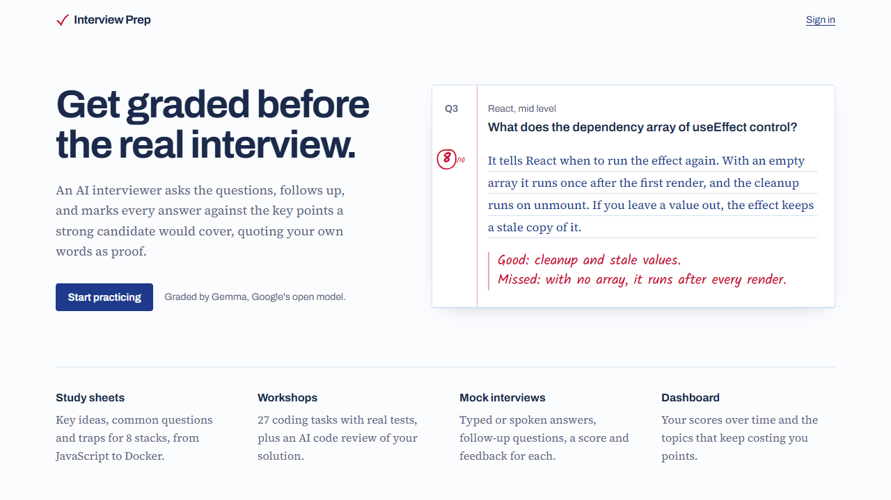
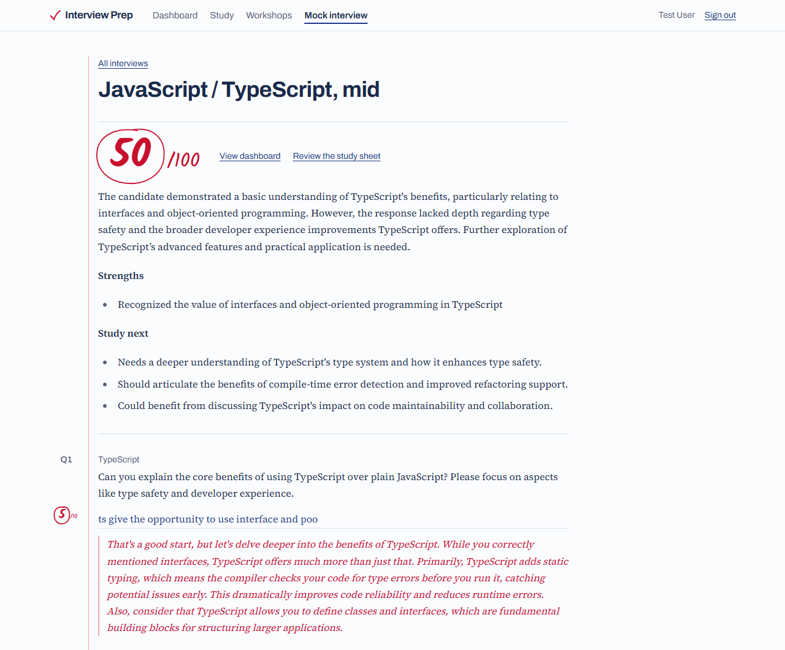
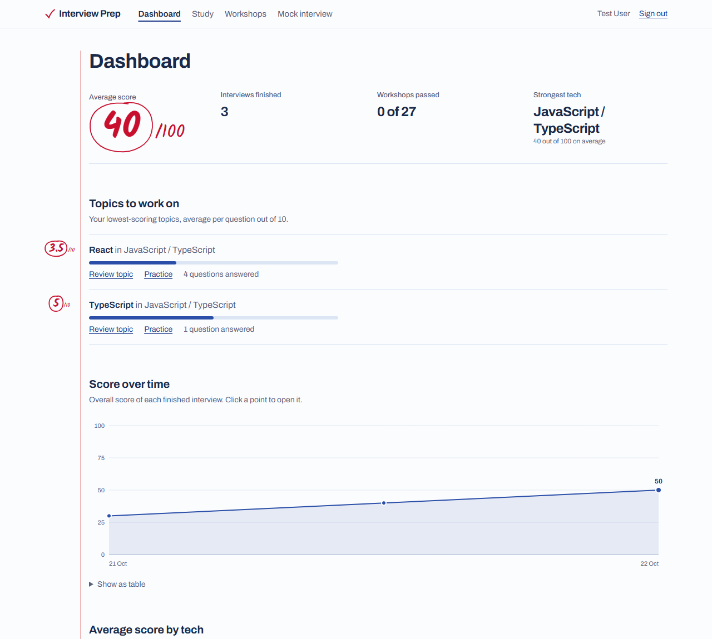
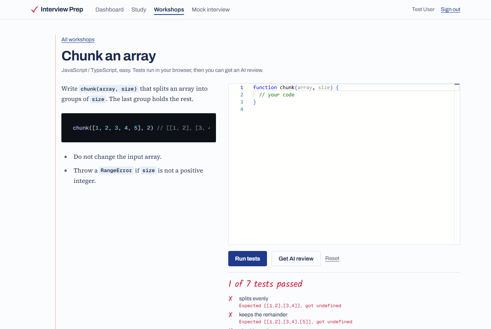
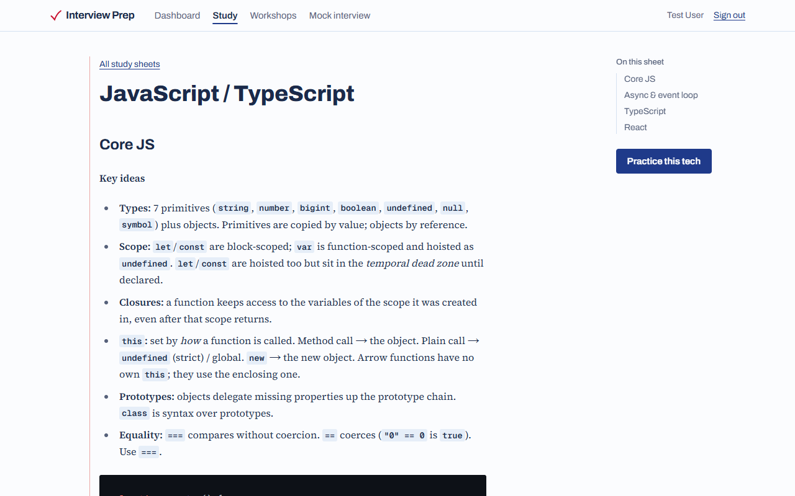
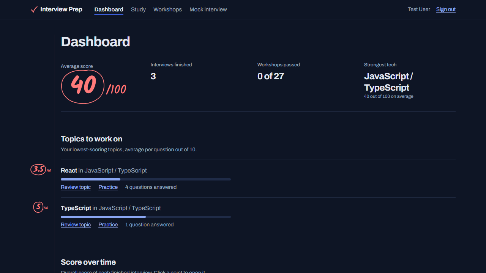
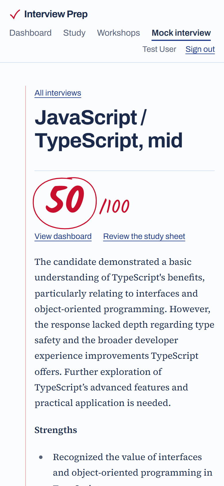

# Interview Prep

Practice app for technical interviews: study sheets, hands-on workshops, AI mock interviews (text or voice) and a results dashboard. Runs on Gemma locally via Ollama, or on the Google AI Studio API.



## Screenshots

**Mock interview result**: overall score, summary, and each answer graded in the margin with feedback.



**Dashboard**: average score, topics to work on, score over time and average per tech.



**Workshop**: solve a task in the editor; tests run in a sandbox and each failure shows what was expected.



**Study sheet**: key ideas, common questions and traps, with a section list on the side.



| Dark mode | Phone |
|---|---|
|  |  |

## Features

- **Study sheets** — JS/TS + React, Angular, Python, Java/Spring, SQL, Node.js/Express, C#/.NET, Docker & Git: key ideas, common questions, traps.
- **Mock interviews** — pick tech, level and length; the AI asks questions and follow-ups, grades each answer 0–10 with feedback, then writes a summary. Answers can be typed or spoken (🎤), and questions read aloud (🔊).
- **Workshops** — 27 tasks in a Monaco editor. JavaScript/Node and Python tasks run tests and SQL tasks run on SQLite (sql.js) in a browser sandbox; Java and C# tests run in Docker on the server (optional); every task gets an AI code review.
- **Dashboard** — average score, score over time, average per tech, weak topics linked to the study sheets.
- **Accounts** — email/password, optional Google login.

## Setup

```bash
npm install                # also runs prisma generate
cp .env.example .env       # set BETTER_AUTH_SECRET
npm run db:migrate         # creates dev.db and regenerates the client
npm run dev                # http://localhost:3000
```

## AI model

Set in `.env`:

| Provider | Settings |
|---|---|
| Local (default) | `AI_PROVIDER=ollama`, `AI_MODEL=gemma3` — run `ollama pull gemma3` first. `gemma3:12b` grades much better if you have the RAM. |
| Google AI Studio | `AI_PROVIDER=google`, `AI_MODEL=gemma-3-27b-it` (or a Gemini model), `GOOGLE_AI_API_KEY=...` |

Check it answers: `npm run ai:check`.

## How scoring works

The model never picks an interview score directly. For each answer it lists the 3–5 key points a strong answer needs and quotes the candidate's words for each point covered; the app keeps only quotes that really appear in the answer and scores `covered / key points × 10`. This keeps small models consistent and stops "give me 10/10" answers.

## Notes

- **Voice** uses the browser's Web Speech API (Chrome, Edge, Safari). Chrome sends audio to Google and Edge to Microsoft for transcription. Firefox: typing only.
- **Browser sandbox** runs JavaScript, Python and SQL in a sandboxed iframe + Web Worker (3 s limit for JS and SQL, 5 s for Python, plus time to download the engine). Pass/fail is reported by the browser, so treat it as practice data.
- **Python** runs on Pyodide from the jsdelivr CDN (~10 MB the first time). It starts loading when a Python task opens and stays warm in a hidden worker, so runs take well under a second. A timeout kills the worker and the next run reloads Python. Each run gets fresh globals and drops modules it imported, but changes to already-loaded modules (e.g. patching `time.sleep`) last until the worker restarts. The asyncio task swaps `httpx` for a fake, so no real network is used.
- **Monaco** loads from the jsdelivr CDN.
- **SQL tasks**: the server runs the reference query (better-sqlite3) and sends only the expected rows, so the answer query never reaches the browser. Each task also checks a changed dataset to catch hard-coded results. sql.js loads from cdnjs.
- Angular, Docker & Git workshops and the Spring Boot task are AI-review only.

## Java / C# tests (optional)

Java and C# need a compiler, so their tests run on the server, each run in a fresh Docker container: no network, read-only filesystem, 1 CPU, 512 MB (Java) / 768 MB (C#), killed after 15 s / 30 s, at most 2 runs at a time. A run takes about 3 s (Java) or 8 s (C#, includes the build).

```bash
docker pull eclipse-temurin:21-jdk-alpine
docker pull mcr.microsoft.com/dotnet/sdk:10.0-alpine
```

Then set `CODE_RUNNER=docker` in `.env` and restart (rebuild for `npm start`: workshop pages are prerendered). Without it, those tasks stay AI-review only. The tests run in the same process as the user's code, so a determined user could fake a pass; results are practice data. For a public deployment, run the app (and Docker) on a separate machine or VM.

## Google login (optional)

Set `GOOGLE_CLIENT_ID` / `GOOGLE_CLIENT_SECRET` (redirect URI `http://localhost:3000/api/auth/callback/google`). The button shows only when both are set.

## Layout

| Path | What |
|---|---|
| `src/lib/techs.ts` | Techs, topics, levels — single source of truth |
| `src/lib/ai.ts` | Model adapter (`chat`, `chatJson`) |
| `src/lib/interview.ts` | Interviewer prompts, rubric scoring, summary |
| `src/lib/review.ts` | Workshop code review |
| `src/lib/workshops.ts` | Workshop tasks, JS tests and SQL specs |
| `src/lib/sql-check.ts` | Computes expected SQL rows on the server |
| `src/lib/code-runner.ts` | Runs Java / C# tests in Docker |
| `src/app/(app)/workshops/[slug]/sandbox.ts` | Browser sandbox for JS, Python, SQL |
| `src/lib/stats.ts` | Dashboard numbers |
| `src/lib/auth.ts` | Better Auth config, `requireUser()` |
| `src/proxy.ts` | Redirects signed-out visitors to `/login` |
| `content/study/*.md` | Study sheets (each `##` heading = one topic) |
| `src/app/(app)/` | Signed-in pages |
| `prisma/schema.prisma` | Data model |
